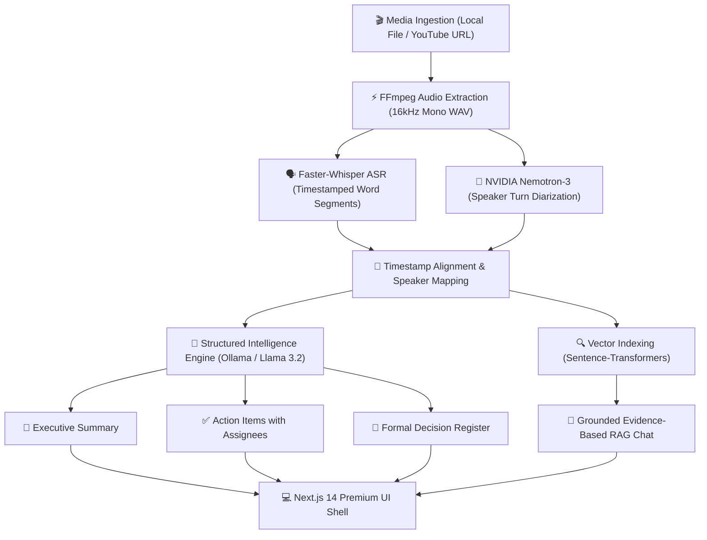

# 🧠 MeetMind — Local-First AI Meeting Intelligence & Organizational Memory

<p align="center">
  
  
  
  
  
  
  
</p>

<p align="center">
  <b>Turn messy meetings into structured executive summaries, tracked action items, and conversational institutional memory — 100% on your own hardware with zero data leakage.</b>
</p>

---

## 💡 The Problem & The Solution

| The Traditional Meeting Nightmare | The MeetMind Solution |
| :--- | :--- |
| ❌ **Hours wasted taking notes** and tracking down who promised what. | ✅ **Automated Deliverables**: Instant executive summaries, decision registers, and action items with owners and deadlines. |
| ❌ **Cloud Privacy & Security Risks**: Uploading confidential corporate strategy to third-party cloud AI vendors. | ✅ **100% Local-First Engine**: All speech recognition, diarization, vector embeddings, and LLM reasoning execute strictly on host hardware. |
| ❌ **Hallucinated AI Summaries**: Chatbots inventing facts, dates, and false decisions. | ✅ **Strict Ground-Truth Citations**: Every single answer includes clickable timestamp citations (`[02:15]`) that jump the video/audio player to the exact second of proof. |
| ❌ **Scattered Organizational Knowledge**: What was agreed upon two weeks ago is lost in chat channels. | ✅ **Cross-Meeting Institutional Memory**: Unified multi-tenant meeting archive with instant retrieval across all discussions. |

---

## ✨ Key Capabilities

- **🎙️ High-Fidelity Speech Recognition & Diarization**:
  Powered by `faster-whisper` (16kHz mono audio) and NVIDIA Nemotron-3 speaker diarization for turn-taking alignment without invasive voice biometrics.
- **🎬 Synchronized Video & Audio Player**:
  Direct media playback for local MP4/WAV/MP3 recordings and synchronized YouTube stream playback with interactive scrubbers, volume controls, and playback speeds (1x to 2x).
- **📋 Three Structured Deliverables**:
  1. **Full Verbatim Transcript**: Speaker-attributed, searchable word-by-word dialogue.
  2. **Executive Summary**: Narrative context, agenda topics, and consensus reached.
  3. **Action Items & Decision Register**: Categorized decisions (`CONFIRMED`, `PROPOSED`, `REJECTED`) and actionable deliverables with assignees.
- **💬 Grounded RAG Meeting Chat**:
  Ask natural-language questions about any meeting (*"What deadlines were agreed upon?"*, *"What blockers were raised?"*). Every fact is cited and clickable.
- **🗑️ Complete Lifecycle Management**:
  Delete meetings in one click from the overview table, archive cards, or meeting detail header with automatic cascading cleanup of media files, transcripts, and embeddings.
- **🎨 Modern SaaS Interface**:
  Built with a soft lavender design system (`#F3F0FF`, `#8B45D6`), rounded surfaces, responsive controls, and zero clutter.

---

## 🏗️ Architecture & Pipeline Flow



---

## 🚀 Quickstart & How to Run

### Prerequisites
- **Python 3.10+** (with virtual environment)
- **Node.js 18+** & `npm`
- **FFmpeg** installed and accessible on system `PATH`
- **Ollama** installed with `llama3.2` model (`ollama pull llama3.2`)

---

### Option 1: One-Click Startup (Windows)

From the project root:

```cmd
start.bat
```
*Or using PowerShell:*
```powershell
.\start.ps1
```
> *This automatically opens Ollama, starts the FastAPI backend, launches the Next.js frontend, and opens [http://localhost:3000](http://localhost:3000) in your browser.*

---

### Option 2: Step-by-Step Manual Launch

#### 1. Start Local LLM (Ollama)
```powershell
ollama serve
```

#### 2. Start Backend API
```powershell
cd backend
# Activate virtual environment
.\venv\Scripts\Activate.ps1   # On Linux/macOS: source venv/bin/activate

# Install dependencies (first time only)
pip install -r requirements.txt

# Launch FastAPI server
python -m uvicorn app.main:app --port 8000 --host 127.0.0.1
```

#### 3. Start Frontend
```powershell
cd frontend
# Install dependencies (first time only)
npm install

# Run Next.js dev server
npm run dev
```

Visit **[http://localhost:3000](http://localhost:3000)** in your browser!

---

## 🛠️ Technology Stack

| Layer | Technology | Role |
| :--- | :--- | :--- |
| **Frontend** | [Next.js 14](https://nextjs.org/) (App Router), React 18, TypeScript | Reactive user interface & synchronized media views |
| **Styling** | [Tailwind CSS](https://tailwindcss.com/), Lucide Icons | Lavender SaaS design system & components |
| **Backend** | [FastAPI](https://fastapi.tiangolo.com/), Python 3.11, Uvicorn | Async REST endpoints, WebSocket streams, and background jobs |
| **Speech-to-Text** | [faster-whisper](https://github.com/SYSTRAN/faster-whisper) (CTranslate2) | 16kHz local speech transcription & word timestamps |
| **Diarization** | NVIDIA Nemotron-3-Diarization architecture | Non-biometric speaker segment boundary detection |
| **LLM Inference** | [Ollama](https://ollama.com/) (Llama 3.2 / Mistral) | On-device structured extraction & conversational RAG |
| **Embeddings** | [sentence-transformers](https://www.sbert.net/) (`all-MiniLM-L6-v2`) | High-dimensional semantic vector search |
| **Database** | [SQLAlchemy](https://www.sqlalchemy.org/) (Async), SQLite / PostgreSQL | Multi-tenant relational persistence with foreign key cascades |
| **Media Engine** | [FFmpeg](https://ffmpeg.org/), `yt-dlp` | Audio extraction, codec normalization, and stream validation |

---

## 🛡️ Anti-Hallucination & AI Governance Principles

MeetMind is engineered around strict **verifiable AI governance**:

1. **Immutable Transcript Truth**: The raw speech-to-text transcript is the immutable source of ground truth. Summaries cannot alter what was recorded.
2. **Mandatory Citations**: Every generated answer references specific segment IDs and second intervals.
3. **No Phantom Owners or Deadlines**: If a meeting participant does not explicitly assign a task or deadline in the audio, the system logs it as unassigned or open-ended.
4. **Zero Voice Biometrics**: Speaker identification is structural (detecting speaker change points), never matching against sensitive voiceprint biometric databases.

---

## 📁 Repository Layout

```
MeetRoom/
├── start.bat                   # One-click Windows CMD launcher
├── start.ps1                   # One-click Windows PowerShell launcher
├── README.md                   # Project overview & quickstart
├── PROJECT_RULES.md            # Architectural rules & AI governance standard
├── ARCHITECTURE.md             # In-depth architectural specifications
├── backend/                    # FastAPI backend
│   ├── app/
│   │   ├── api/                # REST endpoints (meetings, ingestion, chat, health)
│   │   ├── core/               # App configuration, database connection, security
│   │   ├── models/             # Multi-tenant SQLAlchemy database models
│   │   ├── schemas/            # Pydantic request and response schemas
│   │   └── services/           # ASR, Diarization, LLM, and Evidence validation services
│   └── tests/                  # Integration and unit test suites
└── frontend/                   # Next.js 14 frontend
    ├── app/                    # App Router pages (/workspace, /meetings/[id], etc.)
    ├── components/             # Reusable UI components (AppShell, IngestModal, etc.)
    └── public/                 # Static assets
```

---

## 📄 License

This project is licensed under the **MIT License** — see the [LICENSE](LICENSE) file for details.
