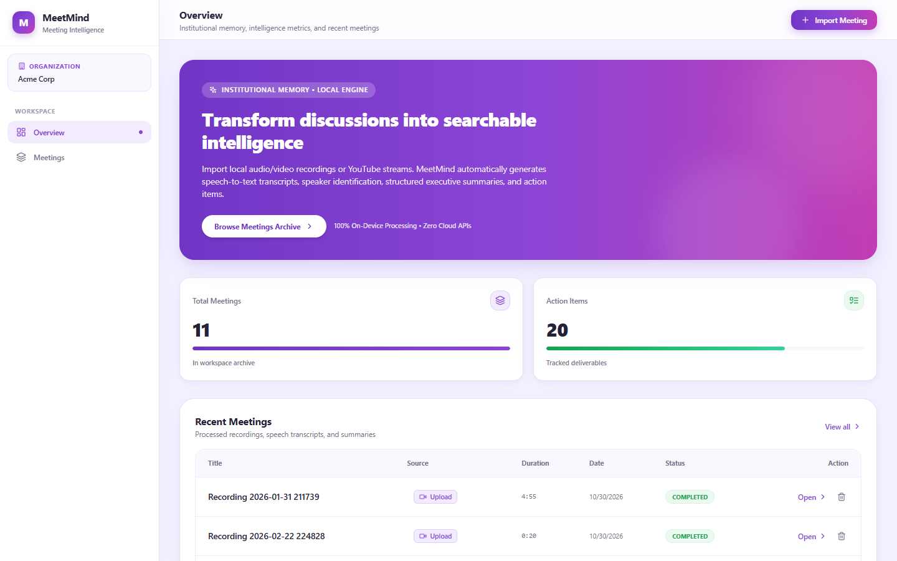
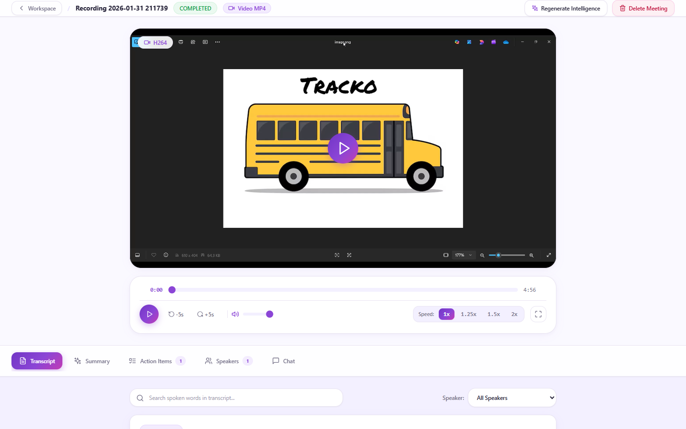
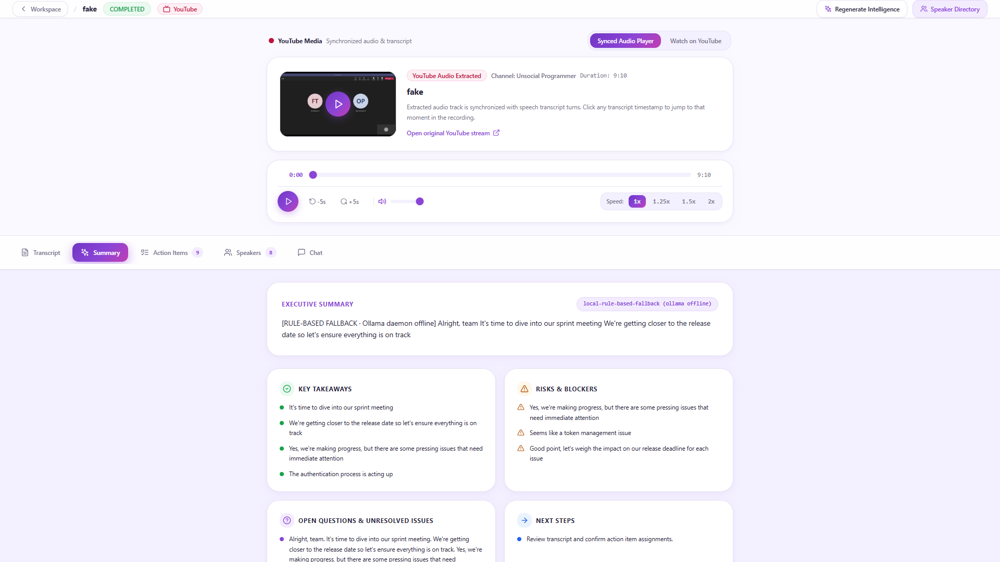
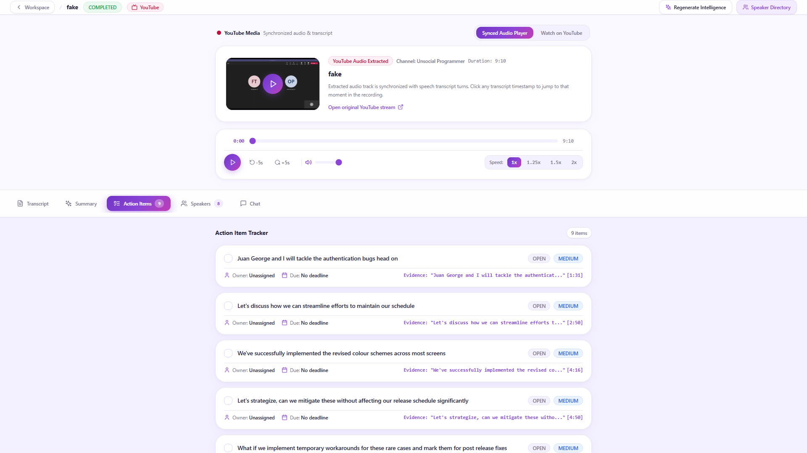
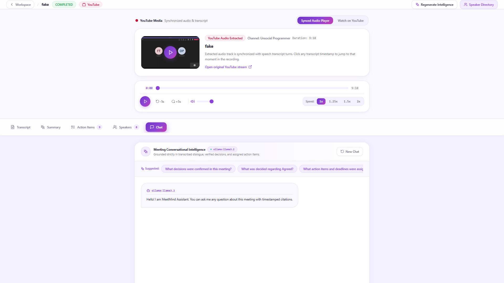
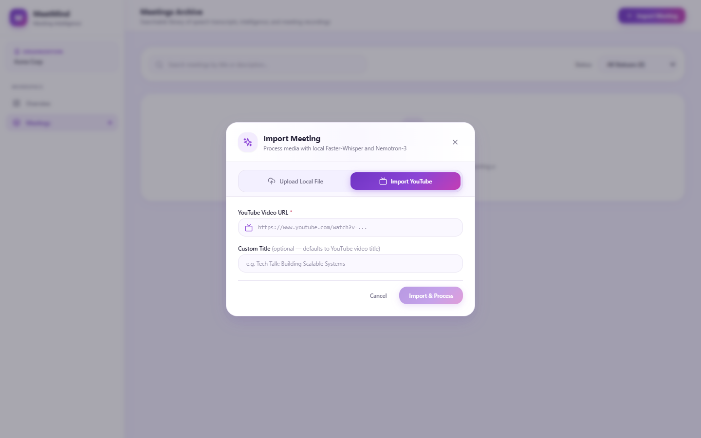
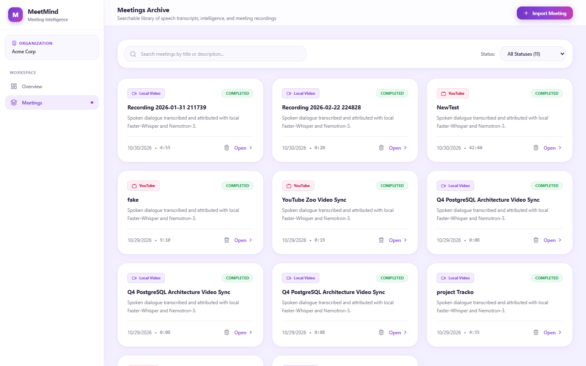
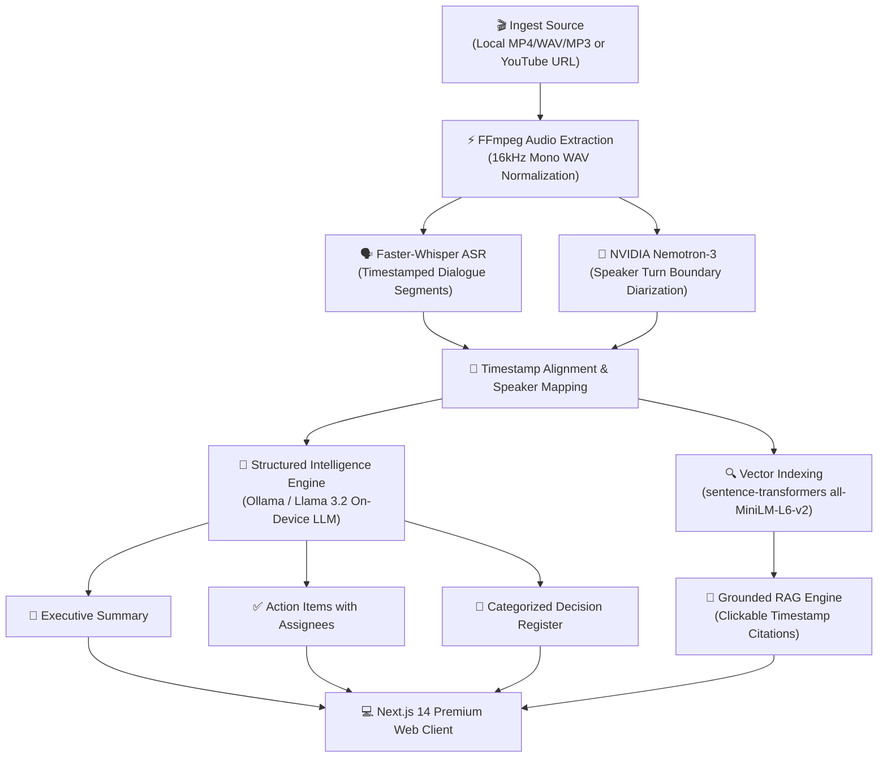

<div align="center">

# 🧠 MeetMind
### Enterprise-Grade Local-First AI Meeting Intelligence & Organizational Memory Platform

[](https://github.com/Bharat-012/MeetMind)
[](https://nextjs.org/)
[](https://fastapi.tiangolo.com/)
[](https://github.com/SYSTRAN/faster-whisper)
[](https://catalog.ngc.nvidia.com/)
[-0052CC?style=for-the-badge)](https://ollama.com/)
[](LICENSE)

<br />

**Transform unorganized meetings into structured executive intelligence, tracked action items, and conversational memory — 100% on your own hardware with zero data leakage.**

<br />

[Features](#-key-features) • [Visual Showcase](#-visual-showcase) • [Architecture](#-architecture--pipeline-flow) • [Quickstart](#-quickstart--how-to-run) • [Tech Stack](#-technical-stack) • [API Reference](#-rest-api-reference)

---

</div>

## 💡 The Problem & The Solution

Every week, organizations lose thousands of productive hours to inefficient meetings, manual note-taking, and lost decisions. Existing cloud solutions upload proprietary voice recordings to third-party servers, creating unacceptable privacy and compliance risks.

| The Challenge | The MeetMind Solution |
| :--- | :--- |
| ❌ **Cloud Privacy & Security Risk**: Proprietary board meetings and product strategies sent to third-party cloud AI vendors. | 🛡️ **100% On-Device Privacy**: Speech recognition, diarization, vector embeddings, and LLM inference run strictly on host hardware. Zero cloud dependencies. |
| ❌ **Hallucinated Summaries**: AI bots inventing deadlines, decisions, and nonexistent meeting attendees. | 🎯 **Strict Verifiable Provenance**: Every answer, decision, and summary links directly to timestamped transcript citations `[mm:ss]`. |
| ❌ **Forgotten Commitments**: Action items buried in raw transcripts or lost in chat threads. | 📋 **Automated Deliverables**: Auto-extracts executive summaries, confirmed decision registers, and structured action items with assignees. |
| ❌ **Disconnected Recordings**: Video and audio files scattered across local drives and cloud drives. | 🎬 **Synchronized Media Player**: Seek video and audio playback word-by-word with interactive highlighting and speed controls. |

---

## 📸 Visual Showcase

### 1. Executive Dashboard Overview
> Clean, modern lavender SaaS workspace showing organizational metrics, tracked action items, and recent meeting activities with instant delete controls.

<p align="center">
  
</p>

---

### 2. Synchronized Media Player & Interactive Transcript
> Watch local MP4/WAV/MP3 recordings or synchronized YouTube streams with real-time word highlighting, speaker turns, and direct timestamp jumping.

<p align="center">
  
</p>

---

### 3. Structured Deliverables: Executive Summary & Action Items
> AI-generated meeting intelligence structured into narrative summaries, key topics, decision logs, and tracked team deliverables with status tracking.

| Automated Executive Summary | Tracked Deliverables & Action Items |
| :---: | :---: |
|  |  |

---

### 4. Grounded RAG Chat with Clickable Timestamp Citations
> Ask natural-language questions about any meeting. Every response includes clickable timestamp citations that seek the video player to the exact second of proof.

<p align="center">
  
</p>

---

### 5. Multi-Source Ingestion & Meetings Archive
> Seamlessly import local audio/video files or public YouTube video URLs with instant extraction, transcription, and searchable archive indexing.

| Clean Ingestion Modal | Searchable Meetings Archive |
| :---: | :---: |
|  |  |

---

## ✨ Key Features

- **🎙️ On-Device Speech Recognition (`faster-whisper`)**:
  Extracts 16kHz mono audio via FFmpeg and performs high-speed transcription with word-level timestamps using CTranslate2 optimization.
- **👥 Non-Biometric Speaker Diarization (NVIDIA Nemotron-3)**:
  Identifies conversational turn-taking and attributes spoken segments (`SPEAKER_00`, `SPEAKER_01`) without invasive voiceprint biometrics.
- **🎬 Universal Media Synchronization**:
  Full video/audio playback with scrubbers, volume toggles, speed controls (1x, 1.25x, 1.5x, 2x), and synchronized YouTube video stream integration.
- **📋 Automated Intelligence Deliverables**:
  - **Executive Summary**: Narrative context, key discussion points, and consensus outcomes.
  - **Decision Register**: Classified by status (`CONFIRMED`, `PROPOSED`, `REJECTED`).
  - **Action Items**: Concrete deliverables with assigned owners and deadline verification.
- **💬 Grounded RAG Chat with Citations**:
  Ask questions like *"What did the team agree to do next?"* or *"What deadlines were committed?"*. Answers cite transcript segments with clickable links that seek media playback to the exact moment.
- **🗑️ Complete Lifecycle & Cascade Deletion**:
  Delete meetings in one click from the overview table, archive cards, or meeting detail header with automatic cleanup of media files, transcripts, and vector embeddings.
- **🎨 Lavender SaaS Design System**:
  Thoughtfully styled with `#F3F0FF`, `#8B45D6`, subtle shadows, and crisp typography for an intentional, enterprise-grade feel.

---

## 🏗️ Architecture & Pipeline Flow



---

## 🚀 Quickstart & How to Run

### System Prerequisites
- **Operating System:** Windows, macOS, or Linux
- **Python:** Version 3.10 or 3.11
- **Node.js:** Version 18.x or 20.x with `npm`
- **FFmpeg:** Installed and added to system `PATH`
- **Ollama:** Installed with `llama3.2` pulled (`ollama pull llama3.2`)

---

### Option 1: One-Click Startup (Recommended)

From the project root (`d:\MeetRoom`):

**Using Command Prompt or double-clicking the file:**
```cmd
start.bat
```

**Or in PowerShell:**
```powershell
.\start.ps1
```

> *This automatically starts the local Ollama engine, initializes the FastAPI backend on port 8000, launches the Next.js frontend on port 3000, and opens [http://localhost:3000](http://localhost:3000) in your browser.*

---

### Option 2: Manual Terminal Launch

#### Terminal 1 — Start Ollama Engine
```bash
ollama serve
```

#### Terminal 2 — Start FastAPI Backend (Port 8000)
```bash
cd backend
# Windows:
.\venv\Scripts\Activate.ps1
# Linux/macOS:
source venv/bin/activate

# Install requirements (first time)
pip install -r requirements.txt

# Start backend server
python -m uvicorn app.main:app --port 8000 --host 127.0.0.1
```

#### Terminal 3 — Start Next.js Frontend (Port 3000)
```bash
cd frontend
# Install dependencies (first time)
npm install

# Start Next.js development server
npm run dev
```

Open **[http://localhost:3000](http://localhost:3000)** in your browser!

---

## 🛠️ Technical Stack

| Category | Technology | Purpose |
| :--- | :--- | :--- |
| **Frontend Framework** | [Next.js 14](https://nextjs.org/) (App Router), React 18, TypeScript | High-performance reactive UI with client components |
| **Styling & UI** | [Tailwind CSS](https://tailwindcss.com/), Lucide Icons | Lavender SaaS design system with custom gradients & elevation |
| **Backend API** | [FastAPI](https://fastapi.tiangolo.com/), Python 3.11, Uvicorn | Async REST API, WebSocket streams, and background tasks |
| **Speech-to-Text (ASR)** | [faster-whisper](https://github.com/SYSTRAN/faster-whisper) (CTranslate2) | 16kHz local audio speech recognition with word timestamps |
| **Speaker Diarization** | NVIDIA Nemotron-3-Diarization architecture | Speaker turn identification without voice biometrics |
| **LLM Inference** | [Ollama](https://ollama.com/) (Llama 3.2 / Mistral) | On-device structured extraction & conversational RAG |
| **Vector Search** | [sentence-transformers](https://www.sbert.net/) (`all-MiniLM-L6-v2`) | High-dimensional semantic embeddings for question retrieval |
| **Database & ORM** | [SQLAlchemy](https://www.sqlalchemy.org/) (Async), SQLite / PostgreSQL | Multi-tenant relational persistence with cascade deletion |
| **Media Processing** | [FFmpeg](https://ffmpeg.org/), `yt-dlp` | Audio extraction, codec transcoding, and stream validation |

---

## 📡 REST API Reference

| Method | Endpoint | Description |
| :--- | :--- | :--- |
| `GET` | `/api/health` | Health check verifying database and active AI providers |
| `GET` | `/api/meetings` | List all meetings with status and pagination filters |
| `POST` | `/api/meetings/upload` | Upload audio/video file and trigger processing pipeline |
| `POST` | `/api/meetings/import-url` | Ingest YouTube video URL, download media, and process |
| `GET` | `/api/meetings/{id}` | Get meeting metadata, media info, and processing stage |
| `DELETE` | `/api/meetings/{id}` | Permanently delete meeting, media files, and deliverables |
| `GET` | `/api/meetings/{id}/transcript` | Retrieve verbatim transcript segments with speaker turns |
| `GET` | `/api/meetings/{id}/summary` | Retrieve structured executive summary and key topics |
| `GET` | `/api/meetings/{id}/action-items` | Retrieve action items with assignees and completion status |
| `GET` | `/api/meetings/{id}/decisions` | Retrieve formal decision register with status tags |
| `POST` | `/api/meetings/{id}/regenerate` | Regenerate summary, decisions, and action items |
| `POST` | `/api/chat` | Query meeting with grounded RAG and timestamp citations |
| `POST` | `/api/chat/stream` | Server-Sent Events (SSE) streaming chat responses |

> Full interactive Swagger documentation is available at **[http://127.0.0.1:8000/docs](http://127.0.0.1:8000/docs)**.

---

## 🛡️ Privacy, Security & Governance

- **Zero Cloud Leakage**: No audio recordings, video streams, or transcripts ever leave your local network or machine.
- **Attribution Governance**: Prohibits biometric voice fingerprinting. Speaker attribution relies strictly on acoustic turn changes and user verification.
- **Strict Anti-Hallucination**: Deliverables and chat responses are grounded in verified transcript segments with foreign-key evidence provenance.
- **Complete Clean Lifecycle**: Deleting a meeting permanently removes the physical media files from disk and cascades through all database records.

---

## 📄 License

This project is licensed under the **MIT License** — see the [LICENSE](LICENSE) file for details.
